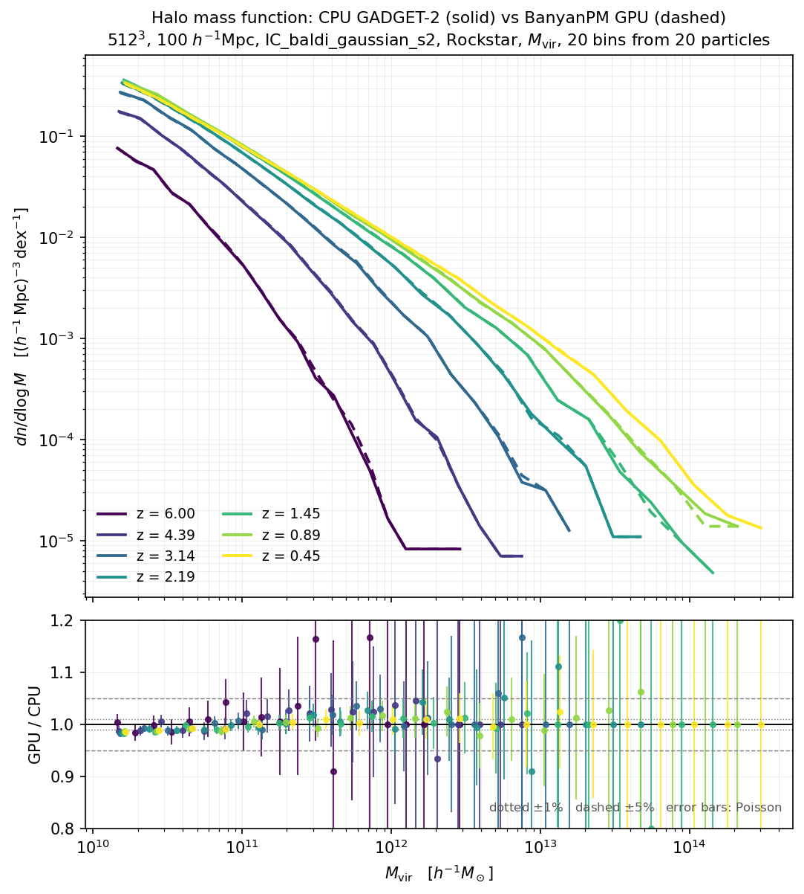

# BanyanPM

**A GADGET-2-compatible cosmological N-body code for AMD GPUs.**

BanyanPM runs collisionless cosmological simulations on a single AMD GPU using HIP/ROCm. It reads
GADGET-2 parameter files and snapshots and writes the same, so existing setups and downstream tools
— halo finders, power-spectrum codes — work unchanged.

It is built on the [Bonsai](https://github.com/treecode/Bonsai) GPU tree code, with the physics
following [GADGET-2](https://wwwmpa.mpa-garching.mpg.de/gadget/): Barnes–Hut and Springel opening
criteria, spline softening, individual timesteps on a power-of-two ladder, and a TreePM
short/long-range split.

A banyan grows one crown on thousands of trunks from a single root system. `PM` is the particle
mesh.

> ### ⚠️ This code was written by an AI and has not been reviewed by a human
>
> Every line was written by **Claude (Opus, Anthropic)** working under the direction of
> [@spilipenko](https://github.com/spilipenko). **No human has read the source.** The validation
> below is real and reproducible, but it is *behavioural* — it demonstrates that the code
> reproduces GADGET-2's results on the runs that were tested, not that the code is correct.
>
> Treat results as unverified. If you use this for science, check it independently first.

---

## Scope

Dark matter only. **There is no SPH, no gas, no cooling and no star formation**, and no MPI — one
GPU, one process. Gas-related parameter keys are parsed and ignored.

Three long-range configurations, all of them GADGET-2 modes, selected at build time:

| | build | long-range force |
|---|---|---|
| **periodic box** | `PERIODIC` + `GADGET_HIP_PMGRID` | TreePM: minimum-image tree, periodic mesh |
| **zoom** | the above + `GADGET_HIP_HIGHRES` | a second, non-periodic mesh refining the high-resolution region |
| **isolated** | `GADGET_HIP_PMGRID` alone | non-periodic mesh on a zero-padded doubled grid, vacuum boundaries |

`PERIODIC` without a mesh is refused at configure time — it would drop the long-range force with
nothing computing it. The isolated mode needs `--meshsize`, and places particles in the first half
of its doubled grid at load, restoring the initial conditions' frame when snapshots are written; see
[`docs/COMPILE_OPTIONS.md`](docs/COMPILE_OPTIONS.md#non-periodic-isolated-runs).

## Build

```bash
cmake -S . -B build \
  -DCMAKE_BUILD_TYPE=Release \
  -DPERIODIC=ON \
  -DGADGET_HIP_PMGRID=512 \
  -DMAC_SPRINGEL=ON
make -C build -j12 gadget_hip
```

| option | effect |
|---|---|
| `CMAKE_BUILD_TYPE=Release` | **Not optional in practice.** A debug build is correct but far slower. |
| `PERIODIC` | Periodic boundaries and the TreePM split. Required for `PeriodicBoundariesOn 1`. |
| `GADGET_HIP_PMGRID=<n>` | Particle-mesh size, GADGET's `PMGRID`. |
| `MAC_SPRINGEL` | Enables the Springel (2005) opening criterion, `TypeOfOpeningCriterion 1`. |
| `UNEQUAL_SOFTENINGS` | Required whenever particle types do not share a softening. |
| `GADGET_HIP_HIGHRES` | The second, non-periodic mesh for zoom runs. |
| `GADGET_HIP_UNIFIED_MEM` | Host-buffer aliasing for large runs — see [Memory](#memory-and-problem-size). |
| `GADGET_HIP_LONGIDS` | 64-bit particle IDs. Matched against the IC's `ID` block width, not sniffed. |

Fifteen options and four sizing constants exist in total; the table above is the set that matters
for a first build. **[`docs/COMPILE_OPTIONS.md`](docs/COMPILE_OPTIONS.md)** documents every one,
including the header constants that set the tree and group sizes, and which combinations are
refused at configure time.

**Four options build cleanly and then refuse at startup if they are missing** — `PERIODIC`,
`MAC_SPRINGEL`, `UNEQUAL_SOFTENINGS` and `GADGET_HIP_LONGIDS`. `PERIODIC` and the ID width are
matched in *both* directions, so a build also refuses inputs that need the option left off. Full
table, with the exact messages, in
[`docs/COMPILE_OPTIONS.md`](docs/COMPILE_OPTIONS.md#read-this-first-four-options-whose-omission-is-not-a-build-error).

One asymmetry to know: `TypeOfOpeningCriterion 1` on a binary built without `MAC_SPRINGEL` is
refused, but `TypeOfOpeningCriterion 0` on a binary built *with* it is **not** — the criterion is
compile-time, so the relative MAC runs whatever the parameter file asks for. The `[INIT] MAC:` line
in the log records which criterion is actually in force; check it before comparing runs.

**MPI is not needed.** The solver contains no MPI references at all; only three legacy utilities
inherited from Bonsai do, and they are off by default (`-DGADGET_HIP_BUILD_BONSAI_TOOLS=ON` builds
them, and then MPI is required).

## Run

```bash
./build/gadget_hip --param run.param                                   # see examples/z0.param
./build/gadget_hip --param run.param --restart-file ckpt.bin           # with checkpointing
./build/gadget_hip --param run.param --restart-file ckpt.bin --resume  # continue
```

Writing a file named `stop` into `OutputDir` ends the run cleanly at the next step boundary, after
writing a checkpoint.

Output: `snapshot_NNN` (GADGET-2 format 1 or 2), `info.txt` (GADGET's per-step line), and `cpu.txt`
(cumulative per-phase timings in GADGET-2's own 18-column format, so it diffs directly against a
GADGET-2 run's file). Energies go to stdout; **no `energy.txt` is written**.

Build options are documented in [`docs/COMPILE_OPTIONS.md`](docs/COMPILE_OPTIONS.md), runtime
switches in [`docs/ENVIRONMENT.md`](docs/ENVIRONMENT.md), and every parameter-file key in
[`examples/annotated.param`](examples/annotated.param). The two switches worth knowing before a
first run:

| variable | default | effect |
|---|---|---|
| `GADGET_HIP_PM_CADENCE` | `1` | Solve the long-range force on PM steps only, as GADGET does. `0` solves it every step. |
| `GADGET_HIP_INVARIANTS` | off | Validate tree and group index structures on every rebuild, and report. Diagnostic; costs a device-to-host copy per rebuild. |

## Memory and problem size

Resident footprint, measured with an allocation ledger rather than estimated, at 512³
(134,217,728 particles):

| build | bytes/particle | 512³ |
|---|---|---|
| default | 440 | 55.0 GiB |
| `-DGADGET_HIP_UNIFIED_MEM=ON` | **333** | **41.7 GiB** |

**`GADGET_HIP_UNIFIED_MEM`** aliases pinned host buffers as device memory, so seventeen large
arrays exist once instead of as a host/device pair. On an APU, where host and device memory are the
same silicon, the device copy is pure overhead. It is what raises the largest problem that fits in
128 GB to roughly **770³**.

It is a trade. Writes through the alias are slower, and the cost grows over a run as the
write-heavy phases take a larger share of each step — about **6% per step early, about 11% by
z ≈ 1**. So it is worth it when a run would not otherwise fit, and not otherwise:

* `GADGET_HIP_UNIFIED_MEM=0` disables it at runtime, with no rebuild, on a binary built with it.
* `GADGET_HIP_UNIFIED_ARRAYS=<bitmask>` selects individual arrays.

Aliasing does not change results. The dynamics are bit-identical with it on and off, including the
timestep sequence.

**`PartAllocFactor` is parsed and ignored.** Allocation is sized from the actual particle count.

### The particle ceiling is 2²⁸ = 268,435,456, and the build enforces it

The tree's leaf indirection packs a leaf's particle count and the index of its first body into one
32-bit word, giving `LEAFBIT = 32 − log2(NLEAF)` bits of index — 28 at the shipping `NLEAF = 16`,
hence 2²⁸ particles. A run above `2^LEAFBIT` **refuses at allocation time**, naming the field and
the limit, rather than truncating the index and walking the wrong particles. The guard follows the
formula, so changing `NLEAF` moves it: a smaller `NLEAF` buys index bits at an accuracy and
performance cost.

Three index structures are watched on every tree rebuild under `GADGET_HIP_INVARIANTS=1`: that
leaves partition `[0, N)` exactly, that groups tile it contiguously in group order, and that the
leaf indirection agrees with the node table. A separate check reports the largest group built
against `NCRIT`.

One physical snapshot file holds at most **178,956,970 particles** — see
[`NumFilesPerSnapshot`](#differences-from-gadget-2).

## Zoom simulations (`PLACEHIGHRESREGION`)

A zoom run resolves one region at high resolution inside a larger, coarser box. GADGET does this
with a **second, non-periodic particle mesh** over the high-res region, on top of the periodic one;
this code does the same.

```bash
cmake -S . -B build-zoom -DCMAKE_BUILD_TYPE=Release \
  -DPERIODIC=ON -DMAC_SPRINGEL=ON -DUNEQUAL_SOFTENINGS=ON \
  -DGADGET_HIP_HIGHRES=ON -DGADGET_HIP_PMGRID=256
./build-zoom/gadget_hip --param zoom.param --zoom-mask 0x2
```

`--zoom-mask` is GADGET's `PLACEHIGHRESREGION` bitmask — bit *t* set means particle type *t* is
high-resolution. `0x2` is the usual choice (type 1 only).

- `--zoom-enlarge` is GADGET's `ENLARGEREGION`, **default 1.2**. Stock GADGET leaves
  `ENLARGEREGION` undefined, but it sits three lines under `PLACEHIGHRESREGION` in GADGET's own
  Makefile with 1.2 filled in, so a real zoom user enables both. The cost is explicit: at fixed
  `GADGET_HIP_PMGRID` the fine cell, `Asmth[1]` and `Rcut[1]` all grow 20% and the fine mesh
  resolves 20% less. Pass `--zoom-enlarge 1.0` for the tightest fine grid.
- `--zoom-recenter` (**default on**) translates every particle at load so the high-res region sits
  at the box centre, and undoes the shift when snapshots are written, so output stays in the
  initial conditions' frame. This is a deliberate *addition*: GADGET refuses to run a dual mesh
  when the region crosses a periodic boundary, which forces you to pre-shift the ICs by hand and
  un-shift every snapshot during analysis. The region centre in a periodic box is computed by
  minimum image against a reference member — exact while the region's extent is under half the box,
  and refusing rather than guessing otherwise.

**Validated against GADGET per particle.** The region geometry is a digit-for-digit match to
GADGET's own (`Asmth[1]` 0.196520, `Rcut[1]` 0.884339, data extent 14.3414, corner 10.0487), and an
instrumented GADGET dumping `GravAccel` and `GravPM` — the latter split into its coarse and fine
parts — gives, on the same 113k-particle zoom at `PMGRID=128`:

| force component | rms difference / \|a_total\| | max |
|---|---|---|
| coarse mesh (periodic) | 2.04e-06 | 4.27e-04 |
| **fine mesh (the zoom grid)** | **1.85e-06** | 1.18e-04 |
| total, high-res particles | 9.29e-04 | 2.06e-02 |

Both meshes agree to float32 round-off. The total on high-res particles is *closer* to GADGET's
production criterion than GADGET's own two opening criteria are to each other (6.19e-03), which is
the right yardstick because it contains none of this code.

Over a full run (`a = 0.02 → 0.5`, 2,709 steps) against a CPU GADGET-2 reference: kinetic and
potential energy within **±0.42%** at all 24 epochs, type-1 `sigma(delta)` within 1.7%, and the
target halo — matched by particle ID, since a halo's position is not reproducible across codes but
its membership is — centred to **0.005–0.007 Mpc/h**, 2–3% of the mean interparticle spacing, with
enclosed mass within 1% outside 0.1 Mpc/h.

**Choosing the mesh size.** Measured at 115M particles, per step over matched 10-step runs:

| PMGRID | `GADGET_HIP_PM_CADENCE=0` | cadence (the default) |
|---|---|---|
| 128 | 4.325 s | **2.673 s** |
| 256 | **3.491 s** | **2.677 s** |
| 512 | 4.565 s | 3.784 s |

Recomputing every step, the cost has a genuine minimum in the middle rather than falling with
resolution: 128 is bound by the coarse mass assignment (115M particles into 128³ is 55 per cell, so
the atomic adds collide constantly) and 512 by the fine-mesh FFT, which is **1024³** because the
zoom mesh is doubled for zero padding.

With the cadence on, 128 and 256 become indistinguishable — on a non-PM step neither does any
coarse-mesh work — so 256 is the finer of two equals, at 31 GB against 512's 47 GB.

Both meshes follow the cadence together, as in GADGET, where `accel.c` wraps the whole of
`long_range_force()`. The interval is GADGET's own choice rather than a fixed number of steps: the
largest power-of-two tick count on the integer timeline not exceeding `dt_displacement`, which on
this run is 16 steps. Amortised over whole PM intervals — the only honest per-step figure, since
one step in 16 does all the mesh work and the rest do none:

| PMGRID=512 | non-PM step | PM step | amortised |
|---|---|---|---|
| cadence | 2.316 s | 8.118 s | **2.580 s** |

Across mesh size the amortised means are 2.580 / 2.595 / 2.728 s for 512 / 256 / 128, so with the
cadence on **512 is both the fastest and the finest**, and memory is the only argument against it.

Deferring the fine force changes the dynamics, so it is validated: on the 113k zoom against the CPU
reference, worst kinetic-energy deviation is **+0.411%** against every-step's +0.435%, and the
ID-matched halo centre lands 0.0094 Mpc/h from the reference against 0.0066 — both unchanged within
noise. The *reported potential* energy is a different matter: see the cadence entry under
[Differences from GADGET-2](#differences-from-gadget-2).

Only the 113k zoom above is validated against GADGET per particle; the 115M run is exercised for
performance and stability, not accuracy, as no CPU reference for it exists.

---

## Validation

Against a CPU GADGET-2 reference run on identical initial conditions: 512³ particles, 100 Mpc/h
box, ΛCDM (Ωm = 0.307, ΩΛ = 0.693, h = 0.678), z = 99 → 0, Springel opening criterion with
`ErrTolForceAcc = 0.002`, PMGRID 512, softening 1/40 of the mean interparticle spacing.

**Energy.** Kinetic energy at all 20 statistics epochs, worst deviation **+0.152%** (at a = 0.81),
every epoch positive and with no trend. The first epoch agrees to all six printed digits, which is
what confirms the initial conditions and unit system are identical rather than merely close.

**Structure at z = 0.** σ(δ) against the reference's own z = 0 snapshot, at four grid resolutions,
because a single one can agree by luck:

| cells per side | CPU GADGET-2 | BanyanPM | |
|---|---|---|---|
| 32 | 3.43988 | 3.44289 | +0.088% |
| 64 | 6.37706 | 6.38380 | +0.106% |
| 128 | 11.24498 | 11.25885 | +0.123% |
| 256 | 17.53811 | 17.53659 | −0.009% |

Agreement holds from 3.1 down to 0.39 Mpc/h, i.e. from the mildly into the deeply non-linear
regime. For scale, the choice of long-range mode within this code moves kinetic energy by up to
0.133% at this resolution — so the two codes agree more closely than this code's own two modes
agree with each other.

**Halo mass function** at z = 0, both catalogues built by the same Rockstar binary with the same
configuration:

| | CPU GADGET-2 | BanyanPM |
|---|---|---|
| haloes | 309,610 | 306,957 (−0.86%) |
| N(> 10¹³·⁵) | 119 | 119 |
| N(> 10¹⁴) | 24 | 24 |
| N(> 10¹⁴·⁵) | 4 | 4 |
| mass-function ratio, median over 20 bins | — | 0.9984 |

**Individual haloes.** Matching the 100 most massive one-to-one: median mass difference **0.26%**,
median position offset **0.0089 Mpc/h** — about 1/22 of the mean interparticle spacing. 88 of 100
agree within 1%; the handful of percent-level outliers are merger-timing differences, which is
ordinary between two independent codes.

**Force accuracy.** 0.39% rms on the fine-particle force against the same reference. The sharper
per-component check, against an instrumented GADGET dumping each particle's short-range and
long-range force separately, is in
[Zoom simulations](#zoom-simulations-placehighresregion) above.

**Halo mass function across redshift**, at all seven epochs where the two output schedules
coincide. Rockstar catalogues on both sides, 20 bins from the 20-particle mass (1.27e10 M⊙/h)
upward; haloes are matched only when a counterpart agrees in **both** position and mass:

| z | N(>20 p) GPU/CPU | N(>100 p) GPU/CPU | matched | median offset | mass bias |
|---|---|---|---|---|---|
| 6.00 | 0.9989 | 1.0199 | 98.86% | 0.0144 | +0.79% |
| 4.39 | 0.9934 | 1.0060 | 98.64% | 0.0151 | +0.81% |
| 3.14 | 0.9918 | 1.0051 | 98.32% | 0.0156 | +0.64% |
| 2.19 | 0.9906 | 1.0008 | 98.21% | 0.0153 | +0.44% |
| 1.45 | 0.9902 | 0.9998 | 98.32% | 0.0154 | +0.30% |
| 0.89 | 0.9908 | 0.9990 | 98.37% | 0.0152 | +0.20% |
| 0.45 | 0.9907 | 0.9999 | 98.53% | 0.0152 | +0.23% |



Offsets in Mpc/h. No mass bin deviates by more than 3σ Poisson at any epoch, and at z = 0.45 the
eight most massive bins reproduce the CPU counts *exactly* (300, 99, 43, 22, 8, 4, 3). The median
halo offset is flat at **15 kpc/h** across a factor of five in expansion factor — it does not grow,
even though individual particle trajectories diverge chaotically (rms 6e-2 Mpc/h between two runs
of the same binary). The residual ~0.9% deficit is confined to the 20–100 particle resolution
limit; above 100 particles the catalogues agree to 3 haloes in 58,240.

**Restart.** Stopping a run and resuming from a checkpoint reproduces the uninterrupted run to
within the PM-atomics noise floor — verified by comparing the stop/resume divergence against a
control of two *uninterrupted* runs of the same binary, which agree no better (median 6.98e-4 vs
6.71e-4 Mpc/h, rms 6.02e-2 vs 6.02e-2).

**Large and multi-species inputs.** A 174-million-particle four-species zoom IC, above the single
file limit, loads from its eleven input files, integrates, writes a snapshot split across two
files and resumes from a checkpoint at the exact step it stopped on. Checked at the byte level: the
per-type counts sum to the input's, every ID appears exactly once, and the per-particle mass block
is present only in the file holding the one species whose header mass is zero.

Note that this validates dark-matter-only, periodic, TreePM runs at one resolution, and the zoom
path at one much smaller resolution. Nothing else has been tested.

## Performance

512³ to z = 0, AMD Strix Halo (gfx1151) against GADGET-2 on 16 CPU cores:

| 512³ to z = 0 | configuration | steps | wall clock | per step |
|---|---|---|---|---|
| **BanyanPM** | cadence | 9,538 | **7.9 h** | **2.98 s** |
| **BanyanPM** | every-step PM, `UNIFIED_MEM=ON` | 9,429 | 9.4 h | 3.58 s |
| GADGET-2 | 16 CPU cores | 9,557 | 48.3 h | 18.20 s |

**6×** on the cadence. The gain is concentrated at late times, where clustering makes the mesh
assignment expensive; the earliest steps are roughly at parity. Read the two BanyanPM rows as
configurations rather than as a clean measurement of the cadence alone — the second also pays the
aliasing cost described under [Memory](#memory-and-problem-size).

The step counts agree with GADGET to **0.2–1.3%**, which is the sharper of the two comparisons: the
timestep criterion is built from the same force GADGET builds it from, so the two codes subdivide
time nearly identically rather than merely arriving at the same place.

**Compare per-step cost, not wall clock, and check the softening first.** Step count is extremely
sensitive to the gravitational softening, and not smoothly: the timeline is quantised in powers of
two, so a softening 4/3 finer can add a whole extra rung to the ladder and with it ~42% more steps,
where a `dt ∝ √ε` estimate would predict ~15%. Two runs of this code at ε = box/512/30 and
ε = box/512/40 took 6.6 h and 9.4 h — at **3.561 against 3.578 s per step**, i.e. the same code at
the same speed on two different physics configurations. A wall-clock comparison across a softening
change measures the softening.

A per-phase breakdown of any run is in its `cpu.txt`. Over a whole z = 0 run with PM every step:
tree walk 29%, tree rebuild 19%, long-range force 18%, Peano-Hilbert reorder 14%, timeline 12%.

The tree walk is issued as **adaptive chunks of active groups**, sized from the previous step's
measured walk time, so no single dispatch occupies the GPU long enough to starve a display stack
sharing it. On a desktop machine expect the session to be sluggish during dense steps.

---

## Invariants the compiler enforces

The hardest bugs in this codebase share one shape: *a quantity is correct where it is stored, and a
transformation is applied to it on only one of several paths to where it is used.* The run
completes, the exit status is zero, and the numbers are plausible. Four such invariants are types
rather than comments, so the mistake does not compile.

| header | what it makes impossible |
|---|---|
| `include/gadget_units.h` | Using a G-free acceleration as if G had been applied. The tree and the mesh both produce G-free forces and G is applied once downstream. |
| `include/gadget_index_spaces.h` | Indexing a particle buffer with the wrong index. Buffers live in up to three index spaces at once and all are `uint`-shaped, so every wrong pairing is in range and plausible; group arrays are a fourth space, and shorter. |
| `include/devFunctionDefinitions.h` | A kernel declaration drifting from its definition. These declarations are used only for their address, so a wrong signature compiles and runs silently. |
| `include/buffer_registry.h` | Guessing which index space a buffer is in: it is recorded as data, with the evidence for each entry. |

A buffer's index space depends on where in the step you are, so the type is on the **kernel
parameter** — declared by whoever knows the phase — not on the buffer.

## Testing

`tests/gate64/gate64.sh <binary>` runs five 64³ boxes to z = 0 against a stored CPU GADGET-2
reference in about five minutes. It checks energy at 20 epochs against GADGET-2 *and* against this
code's own known-good envelope, structure growth at z = 0, two configurations that **must** differ,
and that no optional feature silently declined to engage. It finishes by reproducing a known-bad
configuration and failing if any check accepts it — a gate nobody has seen fail is not a gate.
Every threshold is a measured noise floor, documented with the measurement in
[`tests/gate64/README.md`](tests/gate64/README.md).

It also verifies that the binary under test is the configuration the gate describes: the
`PMGRID=64` banner is asserted directly, and a missing `MAC_SPRINGEL` is caught indirectly, because
the gate's parameter file asks for `TypeOfOpeningCriterion 1` and the binary then refuses it.

`tests/zoom/run.sh` covers the zoom path's host-side geometry — chiefly that the periodic centring
is exact when it claims to be and refuses when it cannot be, since a wrong answer there mis-places
the whole fine mesh.

`gadget_hip --snapshot-test` checks snapshot and IC round-trips, including byte-identity between the
streaming and reference writers and a multi-file round trip where a particle-type run straddles a
file boundary.

---

## Differences from GADGET-2

Read this before trusting a comparison. Items marked **open** are known gaps, not design choices.

- **Dark matter only**, single GPU, single process.
- **Monopole tree**, matching GADGET-2. Bonsai's quadrupole correction is available but off.
- **The long-range force follows GADGET's cadence** by default; `GADGET_HIP_PM_CADENCE=0` solves it
  every step. PM is solved only on PM steps, the interval is the largest power-of-two tick count on
  the integer timeline not exceeding `dt_displacement` — GADGET's own rule — and the stored force is
  applied as a *separate kick over the PM interval, midpoint to midpoint, to every particle exactly
  once*. Measured at 512³ to z = 0: **439 PM solves against GADGET's 438**, worst kinetic-energy
  deviation **0.133%**, and about **17% less wall clock** than recomputing every step; on a zoom run
  it is worth 17–38% of the step depending on mesh size. The banner on the first PM step states
  which mode is in force and whether it was chosen or defaulted.

  Folding the stored force into each active particle's own kick instead — which looks equivalent and
  is not — costs 11% in kinetic energy. Two further consumers of the long-range force need it as
  well, and both follow GADGET: the energy diagnostic, which GADGET drift-corrects back to the
  current time (`global.c:79-87`; without it the reported energy is a sawtooth of up to 2% that
  looks exactly like a dynamics bug), and the opening criterion's `OldAcc`, which GADGET builds from
  tree **and** PM (`gravtree.c:309-311`).

  **One real caveat with the cadence on: the reported `Epot` is a sawtooth** — worst −2.2% against
  the CPU reference, where every-step PM is −0.28%. GADGET recomputes the long-range potential
  fresh at statistics time (`run.c:55` → `compute_potential()` → `pmpotential_periodic()`),
  independent of the PM cadence; this code reads it from the once-per-interval store. It is
  **diagnostic only** — `Epot` is reported but never integrated, and kinetic energy, halo positions
  and halo masses are all unaffected — but it means `Epot` cannot be used to validate a cadence
  run. **Open.**
- **The short-range cutoff is pruned per axis**, as GADGET prunes it (`forcetree.c:1583-1605`),
  rather than on a sphere. The distinction matters because *neither* code applies a hard
  per-particle `r > Rcut` cut — both rely on the erfc table running out at `6·Asmth` — so the
  pruning geometry alone decides whether a pair just past `Rcut` is evaluated, and a Euclidean test
  would cut diagonal neighbours at `Rcut` where the per-axis box reaches `sqrt(3)·Rcut`. The two
  directions are not symmetric: the mesh independently supplies every pair's long-range complement,
  so evaluating an extra far pair is wasted work, while omitting one loses that force outright.
- **The tree is rebuilt every step.** GADGET rebuilds at `TreeDomainUpdateFrequency` and drifts node
  centres of mass in between. **Open**, and the largest remaining cost — tree rebuild plus
  Peano-Hilbert reorder is a third of the wall clock.
- **Integer timeline**, as in GADGET-2. Step boundaries are integer ticks on a 2²⁸ lattice spanning
  `log(a)` from `TimeBegin` to `TimeMax`, so a sync point is exact rather than the nearest
  representable float, and the ladder is a true power-of-two hierarchy. One consequence: a run
  restarted from a *snapshot* is not step-for-step identical to the run it continues, because the
  lattice is anchored to the run's own `TimeBegin`. Checkpoints carry a version tag and a build
  refuses a layout it does not recognise rather than reinterpreting it.
- **Not bit-reproducible.** PM mass assignment uses `atomicAdd` on float, so the density grid
  differs in the last bits between runs and the FFT spreads that across the box. The difference is
  present in the **first force evaluation** and is then amplified chaotically.

  Measured over four runs of one binary at 64³: **0.42% in kinetic energy by z = 0, and ±40 in step
  count.** Attributed to PM by measurement rather than suspicion — excluding the long-range force
  from the dynamics drops the run-to-run spread to 0.0021%, so PM contributes about **157×**
  everything else combined. A single run at that resolution is therefore not a measurement: average
  several, or test a signature noise cannot fake. Any acceptance tolerance must exceed this floor,
  because one tighter than it fails at random. `GADGET_HIP_DETERMINISTIC_CIC=ON` builds a
  fixed-point scatter that *is* bit-reproducible, for A/B testing; it is slower and costs one extra
  grid of `uint64`.
- **I/O**: GADGET-2 formats 1 and 2. `energy.txt` and `timings.txt` are not written — energies go
  to stdout instead. `info.txt` and `cpu.txt` *are* written, both in GADGET's own format.
  Checkpointing uses its own format, not GADGET restart files.
- **`NumFilesPerSnapshot` is honoured, and above a certain size it is not optional.** GADGET's block
  length markers are plain 4-byte ints and POS is 12 bytes per particle, so **one physical file
  cannot hold more than (INT_MAX − 8)/12 = 178,956,970 particles** whatever the machine. The writer
  raises `numFiles` to the minimum the markers allow and says so on stderr: writing more files than
  asked beats writing a truncated one. Naming follows GADGET's `find_files()` convention (`<base>`
  for one file, `<base>.0`, `.1`, … for several). The writer streams from the live arrays one
  262,144-particle chunk at a time rather than staging the snapshot, and the multi-file reader sizes
  its output from the headers and scatters each `(file, type)` run in with one `memcpy` — so a zoom
  IC whose resolution levels arrive out of particle-type order is read without holding two copies.
- **`OutputListOn` / `OutputListFilename` are honoured.** Snapshot times are read from the file,
  filtered to `[TimeBegin, TimeMax]`, sorted and de-duplicated, exactly as GADGET does; entries
  outside the run are normal rather than an error. Two differences, both toward saying something:
  GADGET silently stops reading at 500 entries, this warns instead; and if the list cannot be read
  or holds nothing in range the run stops rather than falling back to `TimeBetSnapshot`.

  One caveat for snapshot-by-snapshot comparisons: GADGET drifts to the output time before writing
  and lands within 1e-8 of it, while this code writes at the step that *crossed* the time,
  overshooting by up to one system step — 1.6e-3 in `a` on the run it was checked against. The
  epoch error is reported per snapshot. Reduce `MaxSizeTimestep` if tighter output epochs matter.
  **Open**, and the fix is a drift-to-output.
- **Parameter keys that are accepted and then ignored**, which is worth checking against your own
  file: the five output-filename keys `EnergyFile`, `CpuFile`, `InfoFile`, `TimingsFile` and
  `RestartFile` (these names are fixed — `cpu.txt` and `info.txt` — and the checkpoint path comes
  from `--restart-file`), `ResubmitOn`, `ResubmitCommand`, `TreeDomainUpdateFrequency`,
  `BufferSize`, `PartAllocFactor`, and the seven SPH keys. `PartAllocFactor` and `BufferSize` look
  like memory controls and are not: allocation is sized from the actual particle count.
- Two keys are **validated rather than ignored**: `TypeOfTimestepCriterion` must be `0` and
  `NumFilesWrittenInParallel` must be `1`; any other value is refused at startup.
- **Every one of GADGET-2's 65 parameter keys is required, and any key outside that set is a fatal
  error** — there is no ignore-unknown mode, so a file carrying keys from GADGET-3, AREPO or an
  optional GADGET-2 module will not start. A stock GADGET-2 gravity-only file is accepted verbatim.
  `examples/annotated.param` is a complete working file with every key annotated.

---

## Licence and attribution

**GPL-3.0-or-later.** See [`LICENSE`](LICENSE) and [`NOTICE`](NOTICE).

- **[Bonsai](https://github.com/treecode/Bonsai)** (Bédorf, Gaburov & Portegies Zwart) is
  Apache-2.0 and is the code this is built on — tree construction, the warp-cooperative traversal,
  the device memory layer and the program skeleton. Apache-2.0 material may be combined into a
  GPLv3 work, which is why GPLv3 and not GPLv2.
- **[GADGET-2](https://wwwmpa.mpa-garching.mpg.de/gadget/)** (Volker Springel) is GPL v2 **or
  later** and is the reference implementation the physics follows and is validated against. Source
  locations are cited throughout the code comments.

**Volker Springel and the Bonsai authors are not involved in this project and do not endorse it.**
The name deliberately avoids both projects' names for that reason. "GADGET-2-compatible" is a
statement about file formats and reproduced results, nothing more.

## Authorship

Written by **Claude (Opus, Anthropic)**, directed by [@spilipenko](https://github.com/spilipenko).

The work was done as a contract-based audit: the code's behaviour was compared against GADGET-2
clause by clause, each discrepancy recorded as a numbered contract or ticket, and each fix required
a positive control — an instrument that cannot be made to fail has not been validated.

See the disclaimer at the top: **no human has read this source code.**
